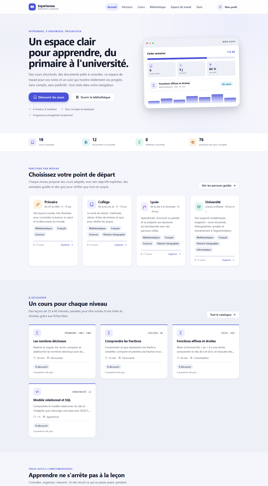

# SepsHaness

**Un espace d'apprentissage en français, du primaire à l'université.**
Cours structurés, documents prêts à consulter, espace de travail personnel et suivi de progression.
Le site est entièrement statique : **sans compte, sans publicité, sans base de données** — tout est
enregistré dans le navigateur du visiteur.

En ligne : [bienvenueduc.com](https://bienvenueduc.com)
Dépôt : [github.com/bienvenu531/Site-Educatif](https://github.com/bienvenu531/Site-Educatif)



---

## Fonctionnalités

- **Parcours** par niveau (primaire, collège, lycée, université) et par matière, avec progression.
- **Cours** complets : objectifs, sections rédigées, encadrés, exemples, tableaux, quiz corrigé et
  expliqué.
- **Bibliothèque** de documents (fiches, méthodes, formulaires, protocoles, cartes mentales,
  annales) lus dans un lecteur Markdown intégré, imprimables.
- **Espace de travail** : notes, tâches, planning de la semaine, minuteur de concentration,
  objectifs.
- **Suivi** : cours terminés, temps d'étude par matière, série de jours, scores de quiz, badges.
- **Profil** : niveau, objectif hebdomadaire, thème clair/sombre, export/import JSON,
  réinitialisation.

Le catalogue compte **19 cours**, **12 documents** et **76 questions de quiz**, répartis sur
4 niveaux et 8 matières (mathématiques, français, sciences, histoire-géographie, informatique,
philosophie, économie, langues).

---

## Stack et principes

- **HTML + CSS + JavaScript vanilla**, aucun framework, aucune dépendance, **aucun build**.
- Aucun CDN tiers, aucune police ni image distante : le site fonctionne hors ligne et en `file://`.
- Persistance via `localStorage` (clé `sepshaness.v1`), export/import JSON.
- Design system centralisé dans `assets/css/base.css` (jetons, composants, thème sombre), décrit
  dans [docs/CONTRAT.md](docs/CONTRAT.md).
- Accessibilité : HTML sémantique, navigation clavier, focus visible, `aria-*`, contrastes vérifiés
  (un point reste à corriger sur le texte secondaire en thème clair, voir l'audit).
- Le site est **statique** : aucune donnée n'est transmise à un serveur.

---

## Démarrage

Prérequis : [Node.js](https://nodejs.org) 18 ou plus (uniquement pour les outils et le serveur de
développement ; le site fonctionne sans Node).

```powershell
npm start
```

Ouvre `http://127.0.0.1:4173/`. Le serveur est sans dépendance (`server.mjs`) et choisit un port
libre à partir de 4173.

Pour simplement consulter le site, `index.html` peut aussi être ouvert directement dans un
navigateur.

---

## Scripts

| Commande | Rôle |
|---|---|
| `npm start` | serveur de développement local |
| `npm test` / `npm run check` | contrôle complet du projet (structure, liens, versions, JS, données, Store, pages légales) |
| `npm run qa` | contrôle navigateur (Chrome/CDP) : desktop 1440, mobile 390/360, erreurs console, captures dans `docs/apercus/` |
| `npm run versionner` | recalcule les paramètres `?v=` des assets dans les pages HTML |
| `npm run avant-mise-en-ligne` | `versionner` puis `check` : à lancer avant chaque déploiement |
| `npm run verifier:prod` | vérifie le site en ligne (pages, 404, sécurité, cache CDN, fraîcheur des assets) |

`npm run qa` nécessite Chrome et un serveur lancé (`npm start`). Le chemin de Chrome peut être
surchargé avec `CHROME_PATH`, l'adresse avec `BASE_URL`.

> Sous Windows, si PowerShell refuse `npm` (`npm.ps1` bloqué par la stratégie d'exécution),
> utilisez `npm.cmd run <script>` : le comportement est identique.

---

## Structure

```text
.
├─ *.html                    8 pages de l'application + 3 pages légales + 404
├─ .htaccess                 HTTPS, en-têtes de sécurité, cache, page 404
├─ robots.txt, sitemap.xml   référencement
├─ server.mjs                serveur statique de développement (sans dépendance)
├─ assets/
│  ├─ css/                   base.css (design system) + styles par page
│  ├─ img/                   favicon
│  └─ js/
│     ├─ data/               catalogue : cours, documents, niveaux, matières
│     ├─ app.js              coquille : en-tête, pied de page, icônes, modale, toast
│     ├─ store.js            persistance localStorage, progression, badges
│     ├─ markdown.js         moteur Markdown (rendu sûr)
│     └─ <page>.js           logique de chaque page
├─ docs/
│  ├─ CONTRAT.md             contrat technique : design system, données, API
│  ├─ DEPLOIEMENT.md         procédure Hostinger, purge du cache, recette, retour arrière
│  └─ apercus/               captures de contrôle
└─ tools/
   ├─ check.mjs              contrôle automatique
   ├─ qa.mjs                 contrôle navigateur
   ├─ versionner.mjs         versionnement des assets
   ├─ verifier-prod.mjs      vérification du site en ligne
   └─ preparer-zip.ps1       archive prête à téléverser
```

Les pages applicatives partagent la même coquille : `app.js` injecte l'en-tête, le pied de page et
les icônes. Les pages légales et la 404 sont autonomes (pas de dépendance à l'application) mais
utilisent le même design system.

---

## Mise à jour des contenus

Les cours et documents sont des données JavaScript pures :

- `assets/js/data/cours-stem.js` et `cours-lettres.js` pour les cours ;
- `assets/js/data/documents-stem.js` et `documents-lettres.js` pour les documents ;
- `assets/js/data/core.js` pour les niveaux, matières, parcours et badges.

Le schéma exact est décrit dans [docs/CONTRAT.md](docs/CONTRAT.md) (§6). Après toute modification :

```powershell
npm run avant-mise-en-ligne
```

Puis suivez [docs/DEPLOIEMENT.md](docs/DEPLOIEMENT.md). Les fichiers `assets/` doivent être envoyés
avec leur nouvelle version `?v=`, sans quoi le CDN continuerait de servir l'ancienne.

---

## Qualité

- `npm test` vérifie la structure des pages, les liens et ressources, la syntaxe des 18 fichiers JS,
  l'intégrité du catalogue (19 cours, 12 documents, 76 questions), le rendu Markdown, l'API du
  `Store` et la conformité des pages légales.
- `npm run qa` mesure les débordements horizontaux, collecte les erreurs console et teste les
  interactions principales (filtres, lecteur, quiz, espace de travail, profil).
- `npm run verifier:prod` contrôle le site réellement servi : en-têtes, redirections, 404, sitemap
  et fraîcheur des assets.

Un rapport d'audit est disponible dans [docs/AUDIT.md](docs/AUDIT.md).

---

## Déploiement

Le site est hébergé chez **Hostinger** (Apache/LiteSpeed). La procédure complète — sauvegarde,
fichiers à envoyer, purge du cache, recette, retour arrière — est dans
[docs/DEPLOIEMENT.md](docs/DEPLOIEMENT.md).

En résumé :

```powershell
npm run avant-mise-en-ligne   # versionner + contrôler
powershell -NoProfile -ExecutionPolicy Bypass -File tools/preparer-zip.ps1
# envoyer dist/site-a-televerser.zip dans public_html/, puis Extraire
# hPanel → Performance → vider le cache, puis :
npm run verifier:prod
```

---

## Droits et contact

Les contenus pédagogiques et l'identité du site sont protégés. Voir les
[mentions légales](https://bienvenueduc.com/mentions-legales.html), la
[politique de confidentialité](https://bienvenueduc.com/confidentialite.html) et les
[conditions d'utilisation](https://bienvenueduc.com/cgu.html).

Contact : [aholoubienvenu296@gmail.com](mailto:aholoubienvenu296@gmail.com)
